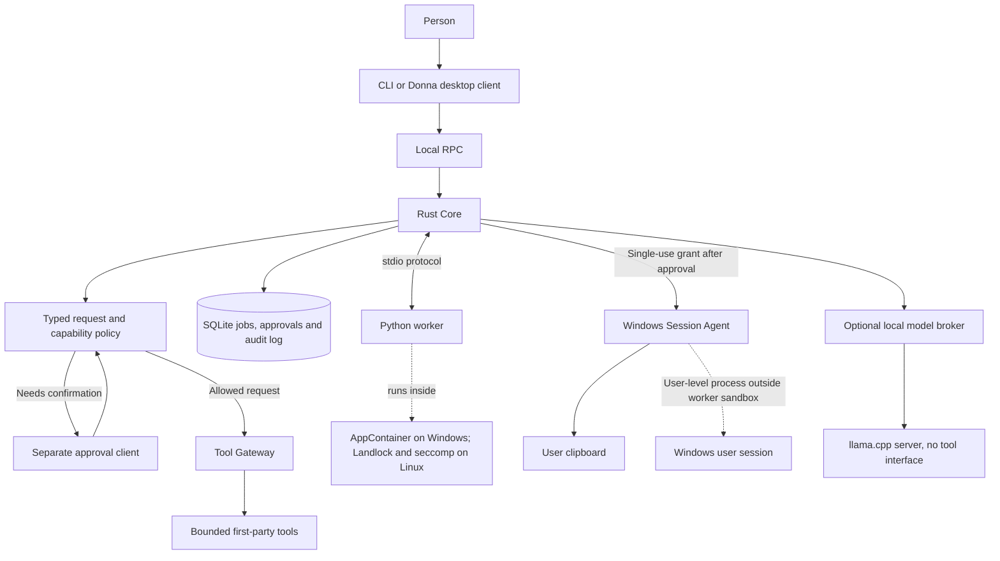

# JARVIS / Donna

A local assistant runtime with a Rust policy core, typed tools, human approval for scoped writes and an OS-isolated worker. A separate Windows Session Agent handles approved clipboard writes. Donna is its desktop client.

**Status:** M7 reliability and privacy work and Donna Experience V1 are merged into `main` ([PR #10](https://github.com/WhiteBlindness/jarvis/pull/10), [PR #11](https://github.com/WhiteBlindness/jarvis/pull/11)). This is a local prototype with a small tool set, not a general autonomous assistant.

[Architecture](docs/architecture.md) · [Threat model](docs/threat-model.md) · [Windows validation](docs/windows-validation.md) · [Decisions](docs/decisions/README.md)

## The problem

Giving an assistant a shell makes permissions hard to explain and audit. JARVIS instead accepts requests for named, typed tools. A Rust Core derives each request's capabilities, applies policy, asks for confirmation when required, records the decision, and then runs the tool.

## Architecture



The worker proposes tool requests but does not grant itself permissions or approvals. The Core owns the policy, durable state and tool execution. The Session Agent is a separate clipboard path that accepts a single-use grant after approval. It and the optional llama.cpp server run as user-level processes outside the worker sandbox. Donna is an RPC client; it does not keep a separate policy or job store.

## What is implemented

- Long-running Core with a typed local RPC interface and command-line client.
- Three bounded Core tools: system information, reading configured fixtures and writing one text file inside a configured workspace.
- A separate Windows Session Agent writes approved text to the clipboard under a single-use grant issued by the Core.
- Desktop capture, clipboard-read and text-entry operations are declared in the protocol but are not implemented as available actions.
- Human approval for workspace writes. Approval binds to the exact task, request, tool, arguments and capabilities, expires and can be consumed once.
- SQLite persistence for jobs, tasks, approvals and an append-only audit log, with crash recovery and quarantine for steps whose outcome is unknown.
- Python worker supervision and OS isolation on Windows and Linux, including a start-up probe that fails closed when required checks fail.
- Donna's Windows desktop screens for Home, Chat, Work, System and Approvals.
- Optional local language-model conversations through a Core-managed `llama.cpp` helper. The model has no tools; its text is not interpreted as an action.

## Security boundaries and known gaps

JARVIS limits what a worker can do, but the operating system remains part of the trust boundary. The Windows worker can read system directories and some registry keys available to AppContainer processes, including parts of `HKEY_CURRENT_USER`. It can obtain a screen device context. Whether screen capture or keyboard-state access is blocked has not been proved. The worker also knows its profile path and can fill its own AppContainer directory until the Core clears it before the next start.

The Python worker is the component confined by AppContainer on Windows or Landlock and seccomp on Linux. The Session Agent and optional llama.cpp server are separate user-level processes outside that worker sandbox. The Session Agent accepts approved clipboard-write grants, but it does not receive the worker's OS isolation guarantees.

Until the registry, screen and keyboard questions are resolved, the worker must not receive model, voice or personal-data integrations. A process running as the same user can use the local RPC interface. Kernel or AppContainer escapes are outside the threat model. See the [threat model](docs/threat-model.md) and [Windows validation notes](docs/windows-validation.md) for scope and evidence.

The optional local model is not evaluated by CI for response quality or GPU behaviour. Its output remains text, not a tool request. A clipboard suggestion appears only after a person asks to copy, and the person must submit and approve the exact text.

## Verification and reproduction

Requirements: Rust 1.89 or newer and Python 3.11 or newer. Linux requires Landlock support (kernel 5.13 or newer); the Core refuses to start the worker if the check fails. On Windows, set `[worker].program = "python"` in `config/jarvis.example.toml` and use a real `python.exe`, not the `py` launcher or a virtual environment. Those launch a second process, which the worker policy refuses. See [Windows validation](docs/windows-validation.md) for interpreter checks. Neither platform requires administrator rights.

Check whether this machine supports the configured worker isolation, then start the Core:

```bash
cargo run -p jarvis-core -- isolation check --config config/jarvis.example.toml
cargo run -p jarvis-core -- serve --config config/jarvis.example.toml
```

In a second terminal, submit a bounded read request and inspect the job and audit records:

```bash
cargo run -p jarvis-core -- submit "describe the runtime, then read welcome.txt" --wait --config config/jarvis.example.toml
cargo run -p jarvis-core -- jobs --config config/jarvis.example.toml
cargo run -p jarvis-core -- audit --config config/jarvis.example.toml
```

A write request waits for a person to inspect and approve its exact arguments. Example configuration files are provided; they contain no credentials.

```bash
cargo test --workspace
cd services/intelligence-python
uv sync
uv run pytest
uv run mypy
uv run ruff check .
```

The Rust tests start Python workers. Keep the test interpreter on `PATH` or set `JARVIS_TEST_PYTHON` to its executable. The CI checks run Rust and Python paths on Linux and Windows, the Donna desktop build on Windows, the documented quick start, minimum Rust version, isolation checks and a secret scan. [PR #11](https://github.com/WhiteBlindness/jarvis/pull/11) records the merged Donna V1 checks. CI does not run a local language model or assess its response quality.

## Development timeline

- **03/10/2026:** Rust Core, typed capability policy, durable state and Python worker introduced in [PR #1](https://github.com/WhiteBlindness/jarvis/pull/1).
- **04/10/2026:** human approval and Windows containment integrated in [PR #2](https://github.com/WhiteBlindness/jarvis/pull/2).
- **13/10/2026:** worker isolation and start-up probes integrated in [PR #3](https://github.com/WhiteBlindness/jarvis/pull/3); durable job recovery followed in [PR #5](https://github.com/WhiteBlindness/jarvis/pull/5).
- **20/10/2026:** same-user Windows RPC authorisation fixed in [commit `0b4e78b`](https://github.com/WhiteBlindness/jarvis/commit/0b4e78b).
- **24/10/2026:** M6 added the desktop client and optional local inference in [PR #9](https://github.com/WhiteBlindness/jarvis/pull/9).
- **26/10/2026:** M7 reliability and privacy work merged in [PR #10](https://github.com/WhiteBlindness/jarvis/pull/10); Donna Experience V1 merged in [PR #11](https://github.com/WhiteBlindness/jarvis/pull/11).

These are integration milestones. They do not imply general autonomy or acceptance for uses outside the documented prototype.

## Planned

Model-backed planning, speech, retrieval and additional tools remain future work. Each new tool needs a threat-model entry and an explicit capability policy before implementation.
